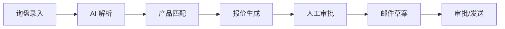

# Fastener AI Export Sales Agent

工业紧固件 AI 外销助手 —— 面向中国中小型紧固件出口工厂的一体化询盘处理、产品匹配、规则化报价与商务邮件生成系统。

> 状态：**试点就绪（pilot-ready）** · 设计基线 v0.9 · MVP 功能开发与工程验收已完成

## 项目定位

将客户询盘转换为可追溯的结构化需求，依据企业授权的产品与价格数据生成报价草案和回复邮件，经人工审批后执行。核心设计原则：

- **LLM 只负责理解与生成**——价格计算、审批、权限等由确定性代码控制
- **数据来源可追溯**——AI 输出关联询盘原文、产品记录、价格规则
- **多租户从第一天设计**——所有业务表具备 `tenant_id`，API 与数据库两层隔离（RLS）
- **Provider 可替换**——LLM、邮件、对象存储均通过适配接口接入

## 核心业务流程



| 状态 | 说明 |
|------|------|
| 询盘 | `RECEIVED → PARSING → NEEDS_INFO → READY_FOR_MATCH → MATCHED → QUOTE_DRAFTED → PENDING_APPROVAL → QUOTE_APPROVED → REPLIED → WON/LOST/ARCHIVED` |
| 报价 | `DRAFT → PENDING_APPROVAL → APPROVED → SENT → EXPIRED/CANCELLED` |
| 工作流 | `QUEUED → RUNNING → SUCCEEDED/FAILED/CANCELLED/WAITING_HUMAN` |

## 技术栈

| 层次 | 选型 |
|------|------|
| 前端 | Vue 3 + TypeScript + Vite + Element Plus + Pinia + Vue Router |
| 后端 | Python 3.12 / FastAPI + Pydantic v2 + SQLAlchemy 2 + Alembic |
| 数据库 | PostgreSQL 16 + pgvector + 行级租户隔离（RLS） |
| 缓存/队列 | Redis 7 |
| 对象存储 | MinIO（S3 兼容） |
| AI 接入 | OpenAI 兼容 LLM 适配层（租户级 Provider 配置 + 确定性 Mock 降级） |
| 部署 | Docker Compose（模块化单体） |

## 功能概览

- **询盘中心**：文本/EML/附件导入、状态机、AI 解析（字段级置信度 + 原文证据 + 冲突标记）
- **产品中心**：产品 CRUD、Excel 模板导入、价格表与阶梯价、知识资料库（PDF/DOCX/XLSX，来源分类与解析状态）
- **报价中心**：规则化报价引擎（价格来源优先级、客户专属价、MOQ 策略、折扣上限）、审批流（禁止自审批）、PDF 导出
- **邮件助手**：多语言报价邮件草案（确定性模板 / LLM）、审批流
- **客户管理**：档案、联系人、专属价覆盖、跟进任务、**备注时间线**
- **AI 工作台**：解析任务状态、邮件草案、**模型用量统计**（token/耗时）
- **企业设置**：企业资料、成员与邀请、价格策略、**租户级 AI Provider 配置**（密钥 Fernet 加密 + 连通性测试）、审计日志

## 目录结构

```
├── backend/                        # FastAPI 后端
│   ├── app/
│   │   ├── ai/                     # 解析器/邮件生成器 + 评测核心
│   │   │   ├── parser.py           #   确定性 + OpenAI 兼容实现
│   │   │   ├── email.py            #   邮件生成（模板 + LLM）
│   │   │   ├── usage.py            #   LLM 用量追踪（token/duration）
│   │   │   └── evaluation.py       #   解析 golden set 评测核心
│   │   ├── api/v1/                 # REST API（15 个路由模块）
│   │   ├── auth/                   # JWT 认证 + 成员邀请
│   │   ├── core/                   # 配置、RBAC 权限、安全、加密
│   │   ├── db/                     # SQLAlchemy、租户上下文（RLS）
│   │   ├── matching/               # 产品匹配 + 评测核心
│   │   ├── models/                 # ORM（20 张表，全部租户隔离）
│   │   ├── pricing/                # 报价引擎（阶梯价/MOQ/客户专属价）
│   │   ├── quotes/                 # 报价服务、审批、PDF 导出
│   │   └── ...                     # 客户、跟进、邮件、审计、工作流
│   ├── migrations/                 # Alembic（20 个迁移）
│   ├── scripts/
│   │   ├── seed_demo.py            # 演示账号
│   │   ├── evaluate_ai_parsing.py  # 解析评测 CLI（--gate）
│   │   ├── evaluate_matching.py    # 匹配评测 CLI（--gate）
│   │   └── e2e_acceptance.py       # 端到端验收（13 阶段）
│   └── tests/                      # pytest（29 个文件，fixtures 含两套 golden set）
├── frontend/                       # Vue 3 管理端
├── markdown/                       # 设计文档（9 篇）
├── docx/                           # 设计文档 Word 版
└── docker-compose.yml
```

## 快速开始

### 方式一：Docker Compose（推荐）

```bash
# 1. 复制环境变量
cp .env.example .env

# 2. 启动全部服务
docker compose up -d

# 服务地址：
#   Web      → http://localhost:8080
#   API      → http://localhost:8000
#   MinIO    → http://localhost:9001
```

`web` 容器使用 Nginx 托管前端静态文件，并将 `/api` 反向代理到 `api:8000`；修改前端代码后执行 `docker compose up -d --build web` 重新构建。

### 方式二：本地开发

```bash
# --- 依赖服务 ---
docker compose up -d postgres redis minio

# --- 后端 ---
cd backend
uv sync
uv run alembic upgrade head
uv run python scripts/seed_demo.py      # 创建演示账号
uv run uvicorn app.main:app --reload

# --- 前端 ---
cd frontend
npm install
npm run dev
```

### 演示账号

| 邮箱 | 密码 | 角色 |
|------|------|------|
| `demo@example.com` | `Demo1234!` | OWNER |
| `manager@example.com` | `Demo1234!` | SALES_MANAGER（审批人） |
| `viewer@example.com` | `Demo1234!` | VIEWER |

## API 文档

启动后端后访问：

- Swagger UI → http://localhost:8000/docs
- ReDoc → http://localhost:8000/redoc

详细接口设计见 [`markdown/04-API接口文档.md`](markdown/04-API接口文档.md)。

## 运行测试

```bash
cd backend
uv run pytest                                    # 单元 + Mock 集成

# 全量集成测试（需 PostgreSQL）
TEST_DATABASE_URL=postgresql+asyncpg://... uv run pytest
```

覆盖：认证 RBAC、产品/价格目录、产品导入、询盘生命周期、AI 解析、产品匹配、报价计算与审批、邮件生成、客户/联系人/跟进/备注、知识资料、企业资料、成员与角色、Provider 配置（密钥加密/掩码）、审计日志、工作流、租户隔离。

## AI 离线评测

固定标注测试集（golden set）作为回归门槛，防止解析/匹配质量静默退化：

```bash
cd backend

# 询盘字段解析评测（验收文档 5.1）
uv run python scripts/evaluate_ai_parsing.py --gate

# 产品匹配评测（验收文档 5.2）
uv run python scripts/evaluate_matching.py --gate
```

| 评测 | 数据集 | 指标 | 当前结果 | 门槛 |
|------|--------|------|----------|------|
| 字段解析 | 30 条标注询盘（中英文/缺字段/拼写错误/多产品/注入等） | 关键字段归一化准确率、误填率 | **100%** / 0% | ≥ 90% / ≈ 0 |
| 产品匹配 | 11 SKU 目录 + 10 条标注需求 | Top-1 / Top-3 / MRR / 硬冲突误判 EXACT | **100% / 100% / 1.0** / 0 | Top-3 ≥ 85% / EXACT 误判 = 0 |

标注集位于 `backend/tests/fixtures/`，CI 可用 `--gate` 的退出码作为质量门禁。

## 端到端验收

`scripts/e2e_acceptance.py` 按 PRD「可试点」清单走通 HTTP 级全流程（13 阶段：导入 50 SKU → 解析 → 匹配 → 报价审批 → 邮件 → PDF 导出 → 审计/用量 → Provider 配置 → 租户隔离）：

```bash
uv run python scripts/e2e_acceptance.py            # 对运行中的 stack 输出 PASS/FAIL 报告
```

最近一次运行：13/13 PASS（详见提交 `2132c12`）。

## 设计文档

| 编号 | 文档 |
|------|------|
| 01 | [PRD 产品需求文档](markdown/01-PRD-产品需求文档.md) |
| 02 | [系统架构设计文档](markdown/02-系统架构设计文档.md) |
| 03 | [数据库设计文档](markdown/03-数据库设计文档.md) |
| 04 | [API 接口文档](markdown/04-API接口文档.md) |
| 05 | [AI Agent 专项设计](markdown/05-AI-Agent专项设计.md) |
| 06 | [报价规则设计文档](markdown/06-报价规则设计文档.md) |
| 07 | [安全与权限设计文档](markdown/07-安全与权限设计文档.md) |
| 08 | [测试与验收文档](markdown/08-测试与验收文档.md) |
| 09 | [部署与运维文档](markdown/09-部署与运维文档.md) |

Word 版本位于 [`docx/`](docx/) 目录。

## 环境变量说明

复制 `.env.example` 并按需修改，关键项：

| 变量 | 说明 | 默认 |
|------|------|------|
| `DATABASE_URL` | PostgreSQL 连接串（asyncpg） | 本地 5433 端口 |
| `REDIS_URL` | Redis 连接串 | 本地 6379 |
| `S3_ENDPOINT` | S3/MinIO 地址 | 本地 9000 |
| `WEB_PORT` | Docker Compose 前端访问端口 | `8080` |
| `LLM_PROVIDER` | `openai` / `openai-compatible` / 空（确定性 Mock） | 空 |
| `LLM_API_KEY` | LLM API Key | — |
| `LLM_MODEL` | 模型名称 | `gpt-4o-mini` |

未配置 LLM 时系统使用确定性正则解析器和模板邮件生成器，适合本地开发和单元测试。租户可在「企业设置 → 模型配置」覆盖全局 Provider（密钥 Fernet 加密存储，支持连通性测试）。

## 路线图

- [x] MVP 全功能（P0 清单）
- [x] 解析/匹配 golden set 评测门槛
- [x] 端到端验收（PRD 可试点清单 13/13）
- [ ] 真实 LLM Provider 接入后的解析评测对比
- [ ] 业务标注集扩展（100~200 条，验收文档建议）
- [ ] UAT 业务验收（邮件质量人工评审，验收文档 5.3/9）

## License

暂未确定，待与业务方确认后补充。
