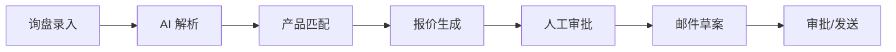

# Fastener AI Export Sales Agent

工业紧固件 AI 外销助手 —— 面向中国中小型紧固件出口工厂的一体化询盘处理、产品匹配、规则化报价与商务邮件生成系统。

> 状态：MVP 开发中（v0.1.0） · 设计基线：v0.9

## 项目定位

将客户询盘转换为可追溯的结构化需求，依据企业授权的产品与价格数据生成报价草案和回复邮件，经人工审批后执行。核心设计原则：

- **LLM 只负责理解与生成**——价格计算、审批、权限等由确定性代码控制
- **数据来源可追溯**——AI 输出关联询盘原文、产品记录、价格规则
- **多租户从第一天设计**——所有业务表具备 `tenant_id`，API 与数据库两层隔离
- **Provider 可替换**——LLM、邮件、对象存储均通过适配接口接入

## 核心业务流程



| 状态 | 说明 |
|------|------|
| 询盘 | `RECEIVED → PARSING → NEEDS_INFO → READY_FOR_MATCH → MATCHED → QUOTE_DRAFTED → PENDING_APPROVAL → QUOTE_APPROVED → REPLIED → WON/LOST/ARCHIVED` |
| 报价 | `DRAFT → PENDING_APPROVAL → APPROVED → SENT → EXPIRED/CANCELLED` |
| 工作流 | `QUEUED → RUNNING → SUCCEEDED/FAILED/CANCELLED/WAITING_HUMAN` |

## 技术栈

| 层次 | 选型 |
|------|------|
| 前端 | Vue 3 + TypeScript + Vite + Element Plus + Pinia + Vue Router |
| 后端 | Python 3.12 / FastAPI + Pydantic v2 + SQLAlchemy 2 + Alembic |
| 数据库 | PostgreSQL 16 + pgvector |
| 缓存/队列 | Redis 7 |
| 对象存储 | MinIO（S3 兼容） |
| AI 接入 | OpenAI 兼容 LLM 适配层（支持确定性 Mock 用于开发/测试） |
| 部署 | Docker Compose（模块化单体） |

## 目录结构

```
├── backend/           # FastAPI 后端
│   ├── app/
│   │   ├── ai/           # 询盘解析器、邮件生成器（确定性 + LLM）
│   │   ├── api/v1/       # REST API 路由
│   │   ├── auth/         # JWT 认证
│   │   ├── core/         # 配置、权限、安全
│   │   ├── db/           # SQLAlchemy、租户上下文
│   │   ├── inquiries/    # 询盘业务逻辑
│   │   ├── matching/     # 产品匹配（加权评分 + 硬约束冲突检测）
│   │   ├── models/       # ORM 模型
│   │   ├── pricing/      # 定价引擎（阶梯价、MOQ、客户专属价）
│   │   ├── quotes/       # 报价服务、文档导出
│   │   └── ...           # 客户、跟进、邮件、审计、工作流
│   ├── migrations/       # Alembic 数据库迁移
│   └── tests/            # pytest 测试（20 个测试文件）
├── frontend/          # Vue 3 管理端
│   └── src/
│       ├── api/          # Axios API 客户端
│       ├── views/        # 页面（工作台、询盘、报价、产品、客户、跟进、AI 工作台、设置）
│       ├── router/       # 路由 + 权限守卫
│       └── stores/       # Pinia 状态管理
├── markdown/          # 设计文档（9 篇）
├── docx/              # 设计文档 Word 版
└── docker-compose.yml
```

## 快速开始

### 方式一：Docker Compose（推荐）

```bash
# 1. 复制环境变量
cp .env.example .env

# 2. 启动全部服务
docker compose up -d

# 服务地址：
#   API      → http://localhost:8000
#   前端     → http://localhost:5173（需单独启动 dev server）
#   MinIO    → http://localhost:9001
```

### 方式二：本地开发

```bash
# --- 依赖服务 ---
docker compose up -d postgres redis minio

# --- 后端 ---
cd backend
uv sync
uv run alembic upgrade head
uv run python scripts/seed_demo.py      # 创建演示账号
uv run uvicorn app.main:app --reload

# --- 前端 ---
cd frontend
npm install
npm run dev
```

### 演示账号

| 邮箱 | 密码 | 角色 |
|------|------|------|
| `demo@example.com` | `Demo1234!` | OWNER |
| `viewer@example.com` | `Demo1234!` | VIEWER |

## API 文档

启动后端后访问：

- Swagger UI → http://localhost:8000/docs
- ReDoc → http://localhost:8000/redoc

详细接口设计见 [`markdown/04-API接口文档.md`](markdown/04-API接口文档.md)。

## 运行测试

```bash
cd backend
uv run pytest
```

测试覆盖：认证 RBAC、产品/价格目录、产品导入、询盘生命周期、AI 解析、产品匹配、报价计算与审批、邮件生成、客户/联系人/跟进、企业资料、审计日志、工作流跟踪。

## 设计文档

| 编号 | 文档 |
|------|------|
| 01 | [PRD 产品需求文档](markdown/01-PRD-产品需求文档.md) |
| 02 | [系统架构设计文档](markdown/02-系统架构设计文档.md) |
| 03 | [数据库设计文档](markdown/03-数据库设计文档.md) |
| 04 | [API 接口文档](markdown/04-API接口文档.md) |
| 05 | [AI Agent 专项设计](markdown/05-AI-Agent专项设计.md) |
| 06 | [报价规则设计文档](markdown/06-报价规则设计文档.md) |
| 07 | [安全与权限设计文档](markdown/07-安全与权限设计文档.md) |
| 08 | [测试与验收文档](markdown/08-测试与验收文档.md) |
| 09 | [部署与运维文档](markdown/09-部署与运维文档.md) |

Word 版本位于 [`docx/`](docx/) 目录。

## 环境变量说明

复制 `.env.example` 并按需修改，关键项：

| 变量 | 说明 | 默认 |
|------|------|------|
| `DATABASE_URL` | PostgreSQL 连接串（asyncpg） | 本地 5433 端口 |
| `REDIS_URL` | Redis 连接串 | 本地 6379 |
| `S3_ENDPOINT` | S3/MinIO 地址 | 本地 9000 |
| `LLM_PROVIDER` | `openai` / `openai-compatible` / 空（Mock） | 空 |
| `LLM_API_KEY` | LLM API Key | — |
| `LLM_MODEL` | 模型名称 | `gpt-4o-mini` |

未配置 LLM 时系统使用确定性正则解析器和模板邮件生成器，适合本地开发和单元测试。

## License

暂未确定，待与业务方确认后补充。