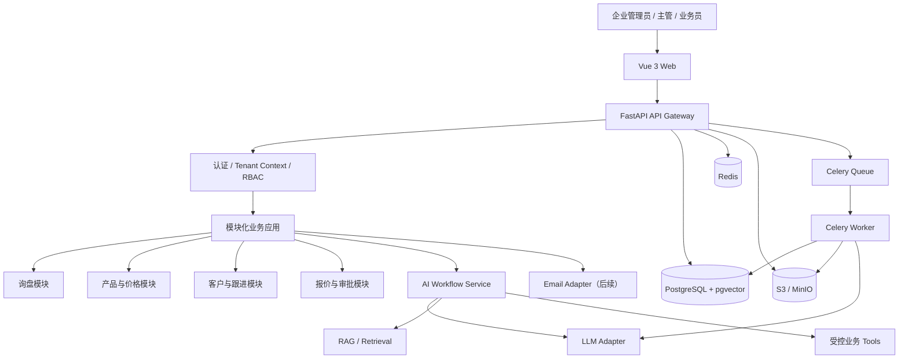

# 02 系统架构设计文档

**项目名称：** Fastener AI Export Sales Agent  
**文档编号：** SAD-002  
**版本：** v0.9  
**日期：** 2026-10-30  
**状态：** MVP 技术基线

## 1. 架构目标与原则

本系统面向中国中小型工业紧固件出口企业，采用 SaaS 多租户模式，并预留企业私有化部署能力。首版由独立开发者实施，架构目标是在控制运维复杂度的前提下，保证业务隔离、价格准确、AI 可控和后续可扩展。

### 1.1 架构原则

1. **模块化单体优先：** 一个 FastAPI 应用按业务域分模块；重型异步任务由 Worker 执行，不因“微服务化”增加初期运维负担。
2. **确定性业务逻辑优先：** 价格、权限、审批、状态流转由代码控制；LLM 仅执行语言理解、提取、匹配辅助和文本生成。
3. **数据来源可追溯：** AI 输出关联询盘原文、产品记录、价格规则或知识文件片段。
4. **多租户从第一天设计：** 所有企业业务表具备 tenant_id，API 与数据库两层实施隔离。
5. **Provider 可替换：** LLM、Embedding、邮件、对象存储均通过适配接口接入。
6. **渐进式复杂化：** MVP 使用显式工作流；复杂中断恢复、多步骤审批等需求出现后再引入 LangGraph 等编排框架。

## 2. 技术选型

| 层级 | 选型 | 说明 |
|---|---|---|
| Web 前端 | Vue 3 + TypeScript + Vite | 单页管理应用 |
| UI 组件 | Element Plus | 后台表格、表单、审批组件 |
| 状态与路由 | Pinia、Vue Router | 登录态和页面路由 |
| 后端 API | Python 3.12+、FastAPI | REST API、依赖注入、OpenAPI |
| 数据校验 | Pydantic v2 | 入参、配置和 AI 输出校验 |
| ORM | SQLAlchemy 2 | ORM 和事务管理 |
| Migration | Alembic | 数据库版本管理 |
| 主数据库 | PostgreSQL 16+ | 关系型业务数据 |
| 向量检索 | pgvector | 产品资料和企业知识语义检索 |
| 缓存/队列 | Redis 7+ | 任务队列 broker、缓存、限流辅助 |
| 异步任务 | Celery | 文件解析、Embedding、模型调用、提醒 |
| 文件存储 | S3 兼容存储，开发可用 MinIO | 原始文件和生成文件 |
| AI 接入 | LLM Provider Adapter | 多厂商模型切换、超时和成本统计 |
| 工作流 | Python 显式状态机/服务编排 | MVP 工作流执行 |
| 反向代理 | Nginx | TLS 终止、静态资源和 API 转发 |
| 部署 | Docker Compose | 初期 SaaS/小型私有化部署 |
| 监控 | 结构化日志、Sentry、OpenTelemetry（逐步） | 错误、链路和运行指标 |

技术版本应在实施时选取受支持的稳定版本并通过依赖锁文件固定；本文中的主版本是设计基线，不替代发布前兼容性验证。

## 3. 逻辑架构

该图表示逻辑依赖关系，不要求每个方框成为独立容器。MVP 建议容器：frontend/nginx、backend、worker、scheduler（可与 worker 分开）、postgres、redis、object-storage。

## 4. 模块边界

| 模块 | 负责内容 | 不负责内容 |
|---|---|---|
| auth | 登录、令牌、密码重置、用户会话 | 企业业务数据决策 |
| tenant | 企业、成员、租户上下文 | 模型推理 |
| product | 产品主数据、规格、自定义属性 | 自行生成产品规格 |
| pricing | 价格表、阶梯价、折扣与底线规则 | LLM 自由计算报价 |
| inquiry | 询盘原文、附件、状态、解析结果 | 邮箱供应商协议细节 |
| knowledge | 文件上传、解析、Chunk、向量索引 | 未经授权跨租户检索 |
| matching | 硬约束过滤、候选排序、理由 | 自动改变客户要求 |
| quotation | 报价快照、版本、审批状态 | 修改源价格表 |
| customer | 客户、联系人、业务时间线 | 外部数据无授权采集 |
| communication | 邮件草案、发送适配器、发送记录 | 绕过审批发送 |
| followup | 待办、提醒、完成状态 | 自动决定商业策略 |
| ai | Prompt、模型适配、工具注册、工作流运行 | 访问任意数据库或无边界执行代码 |
| audit | 审计事件、查询与导出 | 记录明文密钥/不必要的个人信息 |

模块之间通过应用服务接口交互，禁止跨模块直接修改对方表；确需跨模块事务时由应用层编排并定义事务边界。

## 5. 部署拓扑

### 5.1 SaaS 初期

单个云环境或客户区域部署一套共享应用，多个企业共享应用和数据库实例，数据行按 tenant_id 隔离。初期不承诺跨区域多活。建议前端 CDN/静态文件、Nginx、API、Worker、PostgreSQL、Redis、S3 对象存储分层部署。

### 5.2 企业私有化

提供同版本 Docker Compose 包，默认运行在企业 Linux 服务器或企业批准的虚拟化环境。支持将对象存储替换为企业 S3、NAS 适配层或 MinIO；支持配置企业自有模型服务地址。私有化交付需单独确认服务器规格、网络、邮件、备份、模型数据路径和运维责任。

## 6. 关键架构决策

### ADR-001：模块化单体，而不是微服务

- 决策：MVP 使用模块化单体。
- 原因：团队为独立开发，业务边界尚在验证；减少服务部署和分布式事务负担。
- 重新评估条件：独立团队维护不同模块、资源隔离需求明显、单体部署/扩容成为瓶颈。

### ADR-002：PostgreSQL + pgvector

- 决策：结构化数据与向量数据放在 PostgreSQL。
- 原因：初期业务数据量可控，减少数据库运维种类；可在 SQL 中组合租户过滤与业务查询。
- 约束：价格和产品字段始终结构化存储；向量检索不能替代精确 SQL 过滤。

### ADR-003：LLM 不负责最终报价

- 决策：模型输出需求字段和语言草案；后端规则引擎计算金额。
- 原因：金额计算必须可复现、可测试、可审计。

### ADR-004：显式工作流优先

- 决策：先实现可观察的 Python 状态机与任务表。
- 原因：MVP 流程有限；后续有长时任务恢复、复杂分支、人机协作需求再引入专门编排框架。

## 7. 运行时关键流程

### 7.1 询盘解析

1. API 校验用户权限和租户上下文。
2. 保存询盘原文、文件元数据和初始状态。
3. 创建 `workflow_run` 并投递异步任务。
4. Worker 获取租户上下文，读取原始内容和允许访问的知识资料。
5. LLM 返回符合 JSON Schema 的结构化结果。
6. Pydantic 再次校验；不合规则重试一次或转人工处理。
7. 保存字段值、置信度、证据片段和模型版本。
8. 更新询盘状态并记录事件。

### 7.2 报价

应用服务读取已确认需求、产品主数据和适用价格规则，执行确定性计算，生成 quote snapshot。审批服务检查阈值和角色，批准后才可进入 `APPROVED`。邮件服务只读取批准快照。

## 8. 可扩展性与容量起点

MVP 不设未经压测验证的并发承诺。设计上需要：API 无状态化；Worker 可横向增加；任务具备幂等键；数据库连接池限制合理；文件存储与 API 计算分离；Embedding/LLM 设置并发和速率限制。容量指标以压测报告为准。

## 9. 技术债与暂缓项

暂缓 Kubernetes、微服务、独立向量数据库、Kafka、复杂事件总线和多 Agent 自主规划。它们只有在明确业务量、团队规模或部署要求出现后再引入。不要为了技术时髦增加初期成本。

## 10. 架构验收

- 模块边界和依赖方向有代码约束或评审规则。
- 业务表租户过滤统一由服务端上下文提供。
- 文件解析和模型调用异步执行，有超时、重试、失败状态。
- LLM、邮件和对象存储均有接口抽象及 Mock 实现。
- 报价计算与审批不依赖 LLM 输出。
- 本地开发、测试和交付环境可通过配置复现。
