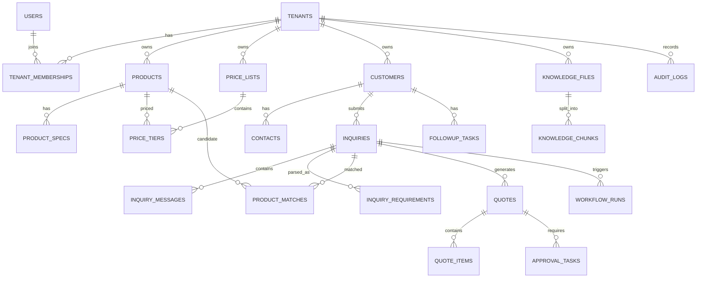

# 03 数据库设计文档

**项目名称：** Fastener AI Export Sales Agent  
**文档编号：** DB-003  
**版本：** v0.9  
**日期：** 2026-10-30  
**数据库基线：** PostgreSQL 16+、pgvector

## 1. 设计目标

数据库支持多租户 SaaS、紧固件产品结构化规格、询盘处理、产品匹配、报价版本快照、审批、客户沟通、知识库和 AI 运行记录。设计优先保证数据隔离、金额准确、历史可追溯和业务状态一致。

## 2. 总体设计原则

1. 平台级表与租户业务表分离；租户业务表必须有 `tenant_id`。
2. 租户 ID 由已验证的服务端会话上下文生成，不接受前端任意指定。
3. 关键业务关系尽量采用复合唯一键和复合外键，降低跨租户错误关联风险。
4. 金额使用 `NUMERIC/DECIMAL`，禁止使用浮点数存储价格金额。
5. 业务主表保留 `created_at`、`updated_at`、必要的 `created_by`；关键状态操作写入事件/审计表。
6. 报价保存快照；产品当前信息、价格表更新不得改变历史报价。
7. 软删除只用于需要恢复或保留历史的数据；法规/合同约定的数据删除另走受控流程。
8. JSONB 用于扩展属性和 AI 原始结构化结果，不替代核心查询字段。

## 3. ER 关系



## 4. 命名与通用字段

- 表名使用复数 snake_case；主键使用 UUID。
- `id` 为主键；租户业务表另设 `(tenant_id, id)` 唯一约束，供复合外键引用。
- 时间统一使用 `TIMESTAMPTZ`，应用层使用 UTC 存储、按用户时区展示。
- 货币使用 ISO 4217 代码（如 `USD`、`EUR`、`CNY`）；数量和单位使用明确字段。
- 状态字段使用受控字符串/数据库约束；枚举值与 API 文档保持一致。
- 所有租户业务表都要定义 `tenant_id UUID NOT NULL`。

## 5. 核心数据表

### 5.1 租户与用户

| 表 | 关键字段 | 说明 |
|---|---|---|
| `tenants` | id, name, slug, status, plan_code, contact_email, contact_phone, website, address, main_products, export_markets(JSONB), default_currency, default_language, created_at, updated_at | 企业租户及企业资料默认值 |
| `users` | id, email, password_hash, display_name, status, last_login_at | 全局用户身份；邮箱唯一性策略需明确 |
| `tenant_memberships` | tenant_id, user_id, role_code, status, joined_at | 用户与企业的成员关系 |
| `member_invitations` | id, tenant_id, membership_id, user_id, token_hash, expires_at, accepted_at, revoked_at, created_by_id, created_at | 一次性成员邀请；仅存令牌哈希 |
| `roles` | id, tenant_id(nullable), code, name, is_system | 平台角色/企业自定义角色 |
| `permissions` | code, description | 权限字典 |
| `role_permissions` | role_id, permission_code | 角色权限关联 |

建议 `tenant_memberships` 对 `(tenant_id, user_id)` 建唯一约束。平台管理员身份另设平台级授权，不通过给所有租户添加 OWNER 角色实现。

`member_invitations` 与 `auth_refresh_tokens` 类似：接受邀请时尚未建立租户上下文，需要先按 `token_hash` 定位记录，因此该表不启用 RLS；访问控制依赖令牌哈希、成员状态与租户状态校验。表中只保存 SHA-256 哈希，明文令牌仅在创建/重发响应中出现一次。

### 5.2 产品与规格

`products` 核心字段：

| 字段 | 类型 | 必填 | 说明 |
|---|---|---:|---|
| id | UUID | 是 | 主键 |
| tenant_id | UUID | 是 | 租户隔离键 |
| product_code | VARCHAR(80) | 是 | 企业内部唯一 SKU |
| product_name | VARCHAR(240) | 是 | 产品名称 |
| category | VARCHAR(30) | 是 | BOLT/NUT/SCREW/WASHER/OTHER |
| standard_code | VARCHAR(80) | 否 | DIN、ISO、ASTM 等标准标识 |
| material | VARCHAR(80) | 否 | 材质，如 SS304、SS316、Carbon Steel |
| grade | VARCHAR(80) | 否 | 性能等级/材料等级，需企业定义语义 |
| diameter | VARCHAR(40) | 否 | 直径，保留 M8、1/4 等原始规格表达 |
| length | VARCHAR(40) | 否 | 长度，如 50mm |
| thread_pitch | VARCHAR(40) | 否 | 螺距 |
| head_type | VARCHAR(80) | 否 | 头型 |
| drive_type | VARCHAR(80) | 否 | 驱动类型 |
| surface_finish | VARCHAR(80) | 否 | 表面处理 |
| sales_unit | VARCHAR(20) | 是 | PCS/KG/SET/LOT 等受控单位 |
| moq | NUMERIC(18,4) | 否 | 最小起订量，单位与 sales_unit 对齐 |
| packaging | JSONB | 否 | 包装规格及说明 |
| attributes | JSONB | 否 | 企业扩展属性 |
| status | VARCHAR(20) | 是 | ACTIVE/INACTIVE/ARCHIVED |
| created_at / updated_at | TIMESTAMPTZ | 是 | 时间 |

建议产品编码唯一约束为 `UNIQUE(tenant_id, product_code)`。用于匹配的字段应建立常规索引或规范化字典；不要只依靠向量搜索识别尺寸和材质。

### 5.3 价格数据

| 表 | 关键字段 | 说明 |
|---|---|---|
| `price_lists` | id, tenant_id, name, currency, valid_from, valid_to, status, version | 价格表版本 |
| `price_tiers` | id, tenant_id, price_list_id, product_id, min_quantity, max_quantity, unit_price, price_basis, unit, valid_from, valid_to | 阶梯价 |
| `customer_price_overrides` | id, tenant_id, customer_id, product_id, currency, unit_price, valid_from, valid_to, approval_status | 客户专属价，可在 MVP 后段启用 |
| `pricing_policies` | id, tenant_id, policy_code, config_json, version, status | 折扣、底线、默认费用和审批策略 |
| `fx_rate_snapshots` | id, tenant_id, base_currency, quote_currency, rate, source, observed_at | 有来源和时间的汇率快照 |

`price_basis` 取值建议：`PER_PIECE`、`PER_KG`、`PER_SET`、`PER_LOT`。数量必须与价格基准单位一致。每个价格记录必须有有效期或明确的长期有效标记，不能把“当前价格”当作永久有效。

### 5.4 客户与联系人

| 表 | 关键字段 | 说明 |
|---|---|---|
| `customers` | id, tenant_id, company_name, country_code, website, source, status, owner_user_id | 客户主档 |
| `contacts` | id, tenant_id, customer_id, name, email, phone, language, job_title, is_primary | 联系人 |
| `customer_notes` | id, tenant_id, customer_id, note, created_by, created_at | 客户备注 |

联系人邮箱应按企业业务需要决定是否唯一；同一联系人可能代表不同客户或存在多个业务邮箱，不宜全局唯一。`contacts` 通过 `(tenant_id, customer_id)` 复合外键归属客户；`is_primary` 使用部分唯一索引保证每个客户最多一个主联系人；邮箱和语言在 API 层校验并归一化，数据库保留格式检查作为兜底。

### 5.5 询盘与解析

| 表 | 关键字段 | 说明 |
|---|---|---|
| `inquiries` | id, tenant_id, customer_id, subject, source_type, source_ref, raw_body, language, status, owner_user_id, received_at | 询盘主表 |
| `inquiry_messages` | id, tenant_id, inquiry_id, direction, sender, recipient, body, occurred_at, file_refs | 对话消息 |
| `inquiry_attachments` | id, tenant_id, inquiry_id, object_key, filename, content_type, size_bytes, checksum, scan_status | 附件元数据 |
| `inquiry_requirements` | id, tenant_id, inquiry_id, schema_version, parsed_json, confirmed_json, confidence_json, evidence_json, model_id | AI 解析结果及人工确认值 |
| `product_matches` | id, tenant_id, inquiry_id, requirement_id, product_id, score, match_status, matched_fields, conflict_fields, unknown_fields, explanation | 候选匹配结果，关联生成时使用的解析版本 |

询盘状态统一使用：`RECEIVED`、`PARSING`、`NEEDS_INFO`、`READY_FOR_MATCH`、`MATCHED`、`QUOTE_DRAFTED`、`PENDING_APPROVAL`、`QUOTE_APPROVED`、`REPLIED`、`WON`、`LOST`、`ARCHIVED`。状态变更应通过应用服务执行并记录事件。

### 5.6 报价与审批

| 表 | 关键字段 | 说明 |
|---|---|---|
| `quotes` | id, tenant_id, inquiry_id, quote_no, version_no, status, currency, subtotal, discount_total, freight_total, grand_total, valid_until, terms_json, source_snapshot_json, created_by | 报价主表及快照 |
| `quote_items` | id, tenant_id, quote_id, product_id(nullable), product_snapshot_json, quantity, unit, unit_price, line_total, price_basis, price_source_ref | 报价行快照 |
| `approval_tasks` | id, tenant_id, object_type, object_id, approval_type, status, requested_by, approver_id, decision_note, decided_at | 审批任务 |
| `quote_events` | id, tenant_id, quote_id, event_type, event_payload, actor_id, created_at | 报价状态历史 |

报价状态统一使用：`DRAFT`、`PENDING_APPROVAL`、`APPROVED`、`REJECTED`、`SENT`、`EXPIRED`、`CANCELLED`。如后续需要“客户已查看/已接受/已拒绝”，建议增加独立客户响应字段或事件，不要与内部审批状态混用。

### 5.7 知识库与 AI 运行

| 表 | 关键字段 | 说明 |
|---|---|---|
| `knowledge_files` | id, tenant_id, filename, object_key, file_type, checksum, parse_status, uploaded_by, created_at | 文件主档 |
| `knowledge_chunks` | id, tenant_id, file_id, chunk_index, content, embedding vector, metadata_json | 文档分块和向量 |
| `workflow_runs` | id, tenant_id, workflow_type, business_object_type, business_object_id, status, input_ref, output_ref, started_at, finished_at, error_code, requested_by, idempotency_key | 工作流运行记录 |
| `ai_usage_logs` | id, tenant_id, workflow_run_id, provider, model, prompt_version, input_tokens, output_tokens, latency_ms, cost_amount, status | 模型调用用量；不存密钥 |
| `prompt_versions` | id, tenant_id(nullable), prompt_key, version, content, status, created_at | Prompt 版本 |

向量字段维度由所选 Embedding 模型固定并记录；模型切换导致维度变化时，使用新索引版本或新列/表重建，不能直接混存不同维度向量。

### 5.8 邮件、跟进与审计

| 表 | 关键字段 | 说明 |
|---|---|---|
| `email_accounts` | id, tenant_id, provider, account_email, encrypted_credentials_ref, status, connected_by | 邮箱连接；MVP 可暂不启用 |
| `email_drafts` | id, tenant_id, inquiry_id, quote_id, subject, body, language, status, approved_by, approved_at, model_id, claims_json, missing_information_json, review_flags_json | 邮件草案；仅基于已批准报价生成 |
| `email_logs` | id, tenant_id, email_draft_id, provider_message_id, recipient_hash, send_status, sent_at, error_code | 发送日志；避免无必要保存明文收件人副本 |
| `followup_tasks` | id, tenant_id, customer_id, inquiry_id, title, due_at, assigned_to, status, source | 跟进任务 |
| `audit_logs` | id, tenant_id(nullable), actor_id, action, resource_type, resource_id, request_id, ip_hash, metadata_json, created_at | 审计事件 |

`followup_tasks.status` 取值 `PENDING`、`DONE`、`CANCELLED`，完成时写入 `completed_at`；`source` 取值 `MANUAL`、`RULE`，MVP 仅由人工创建 `MANUAL` 任务。关联询盘时必须与客户一致，客户和询盘均通过复合外键约束在同一租户内。

## 6. 核心约束和索引

- `products`: `UNIQUE(tenant_id, product_code)`；索引 `(tenant_id, category, status)`、`(tenant_id, standard_code, material)`。
- `customers`: 索引 `(tenant_id, company_name)`、`(tenant_id, country_code)`。
- `inquiries`: 索引 `(tenant_id, status, received_at DESC)`、`(tenant_id, customer_id, received_at DESC)`。
- `price_tiers`: 索引 `(tenant_id, product_id, min_quantity)`，并校验有效期和数量区间。
- `quotes`: `UNIQUE(tenant_id, quote_no, version_no)`；索引 `(tenant_id, status, created_at DESC)`。
- `knowledge_chunks`: 租户过滤字段索引；向量索引由评测和数据规模决定。初期可先精确检索，避免过早使用近似索引。
- `workflow_runs`: 索引 `(tenant_id, status, created_at)`，任务幂等键唯一。
- `contacts`: 索引 `(tenant_id, customer_id)`；部分唯一索引 `(tenant_id, customer_id) WHERE is_primary`。
- `followup_tasks`: 索引 `(tenant_id, status, due_at)`、`(tenant_id, customer_id, due_at)`、`(tenant_id, assigned_to, status, due_at)`。
- `member_invitations`: `UNIQUE(token_hash)`；索引 `(tenant_id, membership_id)`、`(expires_at)`。

## 7. 多租户隔离

采用共享数据库、共享 Schema、行级租户隔离。所有业务查询必须带服务端 tenant_id。建议启用 PostgreSQL RLS 作为纵深防御：在事务内使用 `SET LOCAL app.current_tenant_id = '<tenant-uuid>'`，RLS policy 按当前租户过滤。连接池使用事务级上下文，严禁把会话级租户变量留在可复用连接中。后台任务必须从任务记录验证 tenant_id 后设置数据库上下文。

伪 SQL：

```sql
ALTER TABLE products ENABLE ROW LEVEL SECURITY;
ALTER TABLE products FORCE ROW LEVEL SECURITY;

CREATE POLICY products_tenant_policy ON products
USING (tenant_id = current_setting('app.current_tenant_id', true)::uuid)
WITH CHECK (tenant_id = current_setting('app.current_tenant_id', true)::uuid);
```

`current_setting` 未设置时应返回空值并导致无记录可访问；应用连接账号不得拥有绕过 RLS 的超级用户权限。表所有者、迁移账号与运行账号分离。

## 8. Migration 与数据生命周期

- 所有结构变化通过 Alembic Migration 管理；不得在生产环境手工改表而不回写迁移。
- Migration 应可在空库完整执行，并在 staging 先演练。
- 大表新增字段采用可分阶段迁移；避免单次上线长时间锁表。
- 文件删除应先删除引用/执行归档策略，再根据租户合同与法规要求删除对象存储文件。
- AI 日志保留最小必要内容；Prompt、原始询盘、客户数据是否持久化需配置和告知。

## 9. 关键 SQL 示例

```sql
CREATE TABLE products (
  id UUID PRIMARY KEY,
  tenant_id UUID NOT NULL REFERENCES tenants(id),
  product_code VARCHAR(80) NOT NULL,
  product_name VARCHAR(240) NOT NULL,
  category VARCHAR(30) NOT NULL,
  standard_code VARCHAR(80),
  material VARCHAR(80),
  grade VARCHAR(80),
  diameter VARCHAR(40),
  length VARCHAR(40),
  thread_pitch VARCHAR(40),
  surface_finish VARCHAR(80),
  sales_unit VARCHAR(20) NOT NULL,
  moq NUMERIC(18,4),
  attributes JSONB NOT NULL DEFAULT '{}'::jsonb,
  status VARCHAR(20) NOT NULL DEFAULT 'ACTIVE',
  created_at TIMESTAMPTZ NOT NULL DEFAULT now(),
  updated_at TIMESTAMPTZ NOT NULL DEFAULT now(),
  UNIQUE (tenant_id, id),
  UNIQUE (tenant_id, product_code)
);

CREATE INDEX idx_products_tenant_category
  ON products (tenant_id, category, status);
```

## 10. 数据库验收清单

- 所有租户业务表均有 tenant_id、必要的唯一约束、外键和索引。
- 用户不能通过修改 URL、请求体或对象 ID 访问其他租户数据。
- RLS 与应用层过滤同时生效，运行账号不能绕过策略。
- 金额字段均使用 NUMERIC/DECIMAL；报价生成保存源数据快照。
- 每个枚举值在数据库、后端、前端和 API 文档中一致。
- 空库 Migration、升级 Migration 和恢复备份均经过测试。
