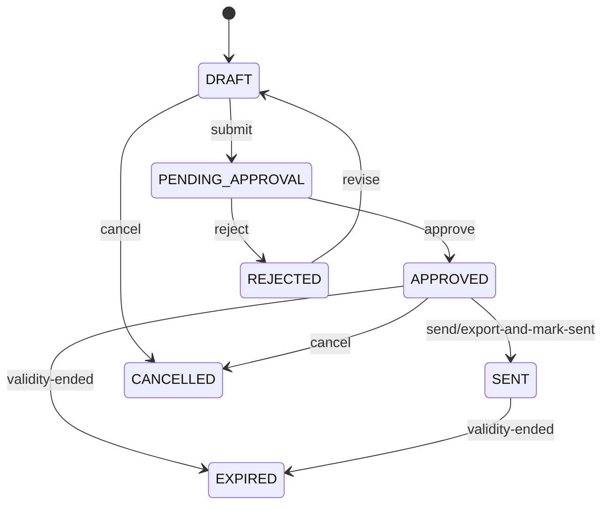

# 06 报价规则设计文档

**项目名称：** Fastener AI Export Sales Agent  
**文档编号：** PRICE-006  
**版本：** v0.9  
**日期：** 2026-10-30

## 1. 设计目标

报价模块是系统的高风险核心。报价金额必须能够复算、解释、追溯，不能由大模型凭语言生成。系统依据企业维护并授权的产品、价格表、客户价格、数量阶梯、币种和费用规则生成报价草案；关键商务条件由人工确认并审批。

## 2. 报价业务对象

- **产品 Product：** 可销售的产品及其规格、计价单位和 MOQ。
- **价格表 Price List：** 企业在特定币种和有效期内维护的一组价格。
- **价格阶梯 Price Tier：** 某产品在数量区间内适用的价格。
- **客户专属价 Customer Override：** 适用于指定客户/产品/币种且已审批的价格。
- **价格策略 Pricing Policy：** 折扣上限、最低成交价/毛利约束、费用和审批规则。
- **报价 Quote：** 一次报价主单，含版本号、状态和快照。
- **报价行 Quote Item：** 产品快照、数量、单位、单价、行金额和来源。

## 3. 产品匹配前置条件

1. 先按产品类别过滤。
2. 按企业配置的必需规格字段过滤，例如标准、材质、直径、长度、等级、表面处理。
3. 必需规格冲突时，状态设为 `CONFLICT`，不可自动进入正式报价。
4. 未知字段不能视为匹配成功；若规格缺失影响选型，询盘转为 `NEEDS_INFO`。
5. 多个可能产品由业务员选择；AI 只提供候选项和理由。
6. 非标件、图纸核价或需工程确认的产品必须走人工核价路径。

## 4. 价格来源优先级

建议默认优先级（企业可通过版本化规则配置，但变更须审批）：

1. 已审批、有效期内的客户专属价。
2. 当前客户适用的合同价/项目价（若企业启用）。
3. 有效价格表中的产品阶梯价。
4. 经授权的人工单次报价输入（必须记录来源、经手人和审批）。
5. 无可用价格：阻止报价，提示“需要维护价格或人工核价”。

不得将历史报价自动当成当前有效价格；不得因模型“知道市场价格”而补出价格。

## 5. 计价单位与数量规则

初始支持：

- `PER_PIECE`：每件/PCS。
- `PER_KG`：每公斤/KG。
- `PER_SET`：每套/SET。
- `PER_LOT`：每批/LOT。

报价输入必须说明数量单位和价格基准单位。若客户数量是 PCS，而价格按 KG，必须存在明确、经企业维护的单位换算关系或单件重量参数，才能计算。不能由 LLM 猜测单位换算。

MOQ 检查：`requested_quantity < moq` 时标记 `BELOW_MOQ`。允许例外的情况下必须由具备权限人员填写例外原因并审批。

阶梯选择：对同一产品、币种、价格表和有效日期，选取满足 `min_quantity <= q <= max_quantity` 的阶梯，并按企业配置的规则决定价格；默认选择满足条件且 `min_quantity` 最大的阶梯。数量区间不得重叠，空缺区间应返回不可报价。

## 6. 金额计算规则

### 6.1 基本公式

对按当前销售单位计价的报价行：

`line_subtotal = quantity × unit_price`

`quote_subtotal = Σ line_subtotal`

`discount_total = 按批准的折扣规则计算`

`grand_total = quote_subtotal - discount_total + freight_total + other_charges`

具体是否包含税费、保险、包装、模具或运费，须由企业配置；未提供的数据不应默认填零并描述为“已包含”，应明确标记为未报价/待确认。

### 6.2 Decimal 与舍入

- 数据库使用 `NUMERIC`，Python 使用 `Decimal`，禁止 float。
- 汇总前保留足够内部精度；最终展示按币种精度舍入。
- 单价、行金额、折扣、运费、总价分别保存未舍入或规则化后的计算值及显示值。
- 舍入模式（如 `ROUND_HALF_UP`）由系统统一配置，不允许各页面自行处理。

### 6.3 币种与汇率

- 报价必须有目标币种。
- 若价格表币种与报价币种一致，直接使用价格表单价。
- 若币种不同，只有在企业配置了合法汇率来源并保存汇率快照时才允许换算。
- 汇率快照记录 base、quote、rate、来源、抓取/确认时间和审批状态。
- 汇率变化不影响已生成报价快照；重新报价必须明确触发重新计算并生成新版本。
- MVP 可先要求企业直接维护目标币种价格，暂不自动换汇。

## 7. 费用、贸易条款和交付条件

- Incoterms 使用受控代码（如 EXW、FOB、CFR、CIF、DAP、DDP）；具体版本/地点必须记录，例如 `FOB Ningbo, Incoterms 2020`。
- 运费、保险、清关费用、关税等只能来自人工输入、承运商/供应商接口或企业规则，不允许模型估算后作为正式报价。
- 付款方式、交期、包装、证书、样品费等由企业设置默认值或每单确认。
- 没有来源的数据在报价单上应显示为“待确认”或不显示，不能编造为确定承诺。

## 8. 折扣、毛利与价格底线

企业可配置以下策略：

- 最大业务员折扣百分比。
- 主管可审批折扣上限。
- 低于最低成交价或最低毛利率的阻止规则。
- 不同客户等级、产品类别、数量区间的价格策略。
- 特价审批原因与审批链。

如果企业没有成本价/毛利数据，系统只能执行企业维护的最低单价/最低折扣规则，不能声称保护毛利率。

## 9. 报价审批规则

MVP 建议所有正式报价必须经人工审批。后续可以根据风险配置审批阈值，但不能取消安全阻断项。

| 条件 | 系统动作 | 审批要求 |
|---|---|---|
| 价格缺失/过期 | 阻止生成可审批报价 | 先补价格或人工核价 |
| 产品关键规格冲突 | 阻止自动报价 | 业务员/工程师确认 |
| 低于 MOQ | 标记异常 | 主管特批 |
| 折扣超业务员权限 | 阻止提交或转交主管 | 主管审批 |
| 低于价格底线 | 阻止批准 | 特殊授权人处理，策略可禁止例外 |
| 汇率缺失/过期 | 阻止换算报价 | 维护汇率/改用目标币种价格 |
| 常规有效报价 | 生成草案 | 指定审批人批准 |
| 已批准报价内容变更 | 旧批准失效或创建新版本 | 重新审批 |

## 10. 报价状态机



`SENT` 只能由完成发送或经人工确认的外部发送记录触发，不得仅因生成 PDF 就标记为 SENT。对已批准报价作任何影响价格、产品、数量、币种或贸易条款的修改，必须创建新版本并重新审批。

## 11. 报价快照与审计

每份报价至少保存：

- quote_no、version_no、状态、创建人、审批人、审批意见。
- 产品 ID（可空）及产品名称、编码、完整规格快照。
- 数量、销售单位、计价基准、单价、行金额。
- 价格表 ID、价格行 ID、价格版本、价格有效期。
- 币种、汇率来源和汇率快照（如适用）。
- 折扣、运费、其他费用、总价及舍入规则。
- Incoterms、地点、付款条款、交期、包装、报价有效期。
- 本次计算的规则版本和计算输入快照。

## 12. 计算服务伪代码

```python
from decimal import Decimal


def calculate_quote_line(quantity: Decimal, unit_price: Decimal) -> Decimal:
    if quantity <= 0:
        raise ValueError("quantity_must_be_positive")
    if unit_price < 0:
        raise ValueError("unit_price_must_not_be_negative")
    return quantity * unit_price


def resolve_price(product_id, quantity, currency, customer_id, as_of):
    # 1. 校验租户和产品状态
    # 2. 检查客户专属价是否有效且已审批
    # 3. 否则查询有效价格表和数量阶梯
    # 4. 校验币种、计价单位、MOQ、有效期和规则版本
    # 5. 无唯一有效价格则返回明确不可报价原因
    pass
```

## 13. 报价测试场景

至少覆盖：阶梯边界前/边界/边界后、MOQ 边界、价格表起止日期、客户专属价优先级、过期价格、无价格、数量单位不一致、币种一致/不一致、汇率缺失、折扣上限、低于底线、运费未提供、重复报价、报价内容修改后旧审批失效、不同租户同产品编码。

## 14. 验收标准

- 所有金额计算使用 Decimal，并与独立人工核算样例一致。
- 无有效价格、无合法换算、价格过期或必需规格冲突时不能生成可发送报价。
- 报价快照可以在源数据更新后复现当时金额。
- 已批准报价被修改后必须重新审批。
- 审批记录包含操作人、时间、动作和原因。
- LLM 不参与最终金额的数值计算和价格底线裁决。
